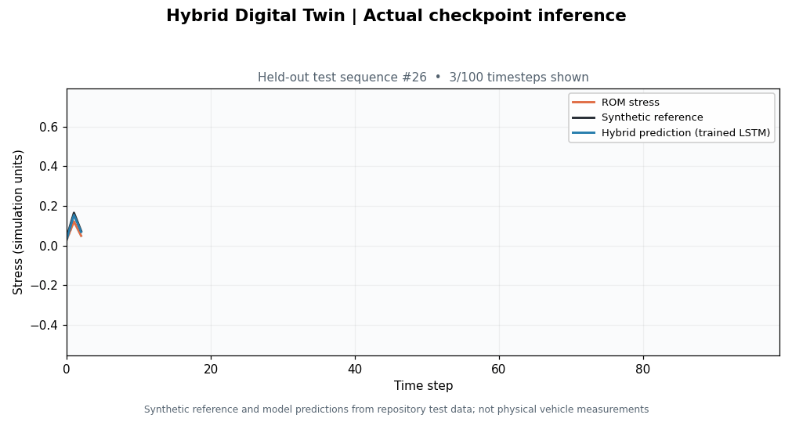
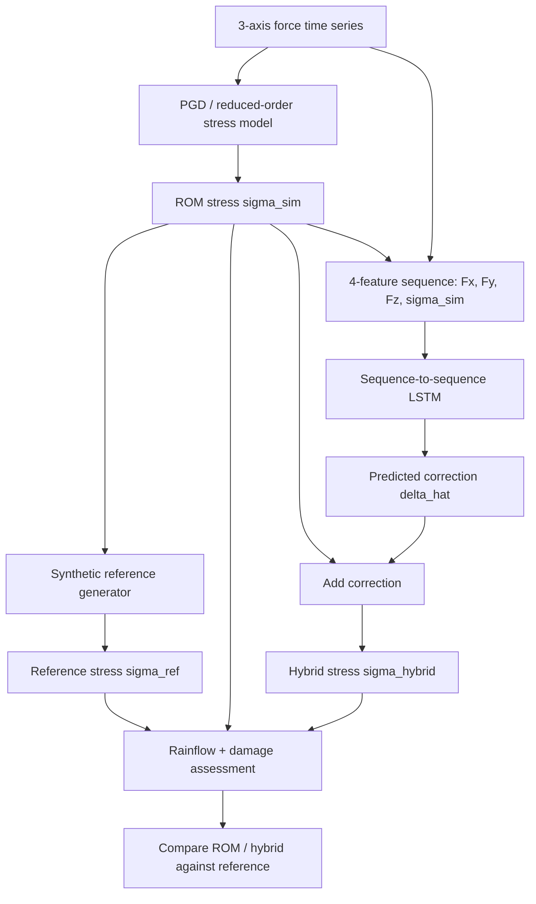
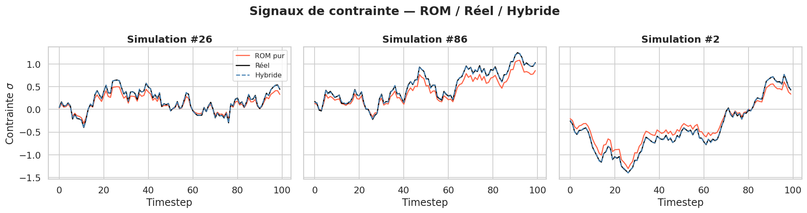
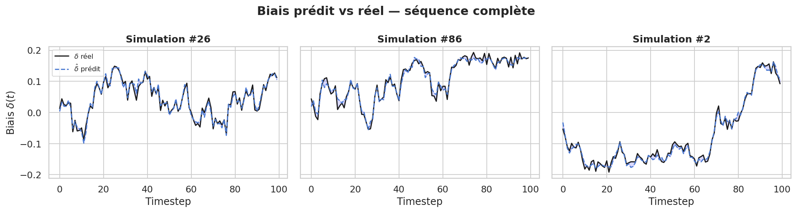
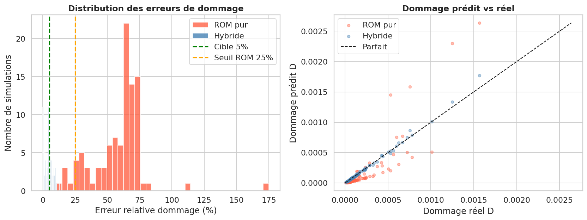

# Hybrid Digital Twin for Automotive Fatigue Analysis

**Physics-informed modeling · Time-series deep learning · Fatigue damage estimation**

A research prototype that combines a **Proper Generalized Decomposition (PGD) reduced-order model (ROM)** with a **sequence-to-sequence LSTM** to estimate and correct stress signals used in automotive suspension durability analysis.

> **Research question:** Can a fast physics-based approximation be corrected using data-driven learning so that fatigue-damage estimates more closely match a reference signal?

<p align="center">
  
</p>

> **Animation provenance:** All three curves come from a single held-out test sequence (index **26** in `dataset/data/X_test.npy` / `y_test.npy`). The hybrid curve is **actual inference** from `outputs/checkpoints/best_bias_learner.pt`, with the stored input/output scalers. The GIF progressively reveals the same fixed predictions; it does **not** illustrate online learning or show physical sensor recordings. Reference data are synthetically generated. The checkpoint and arrays are included in this repository.

### Verified animation results (one held-out sequence)

- Source: repository `X_test.npy`, `y_test.npy`, `scaler_X.pkl`, `scaler_y.pkl`, and `best_bias_learner.pt`.
- Sequence: test index **26**, **100** timesteps; original model checkpoint epoch **50**.
- Mean absolute stress error on this example: ROM **0.0572**, hybrid **0.0077** (simulation units). This is **one illustrated example**, not an aggregate benchmark.
- Computed with the `BiasLearner` LSTM model definition and checkpoint `model_state_dict`, using model evaluation mode.

## Why this matters

Fatigue assessments depend on stress histories. A computationally inexpensive surrogate can approximate system behavior, but errors in the stress history can propagate into cumulative-damage estimates. This proof of concept asks whether learning a time-dependent correction to the ROM output can improve the stress signal used for damage estimation.

This repository is an **academic, synthetic-data prototype**, not a validated digital twin of an instrumented vehicle. The data generator uses a prescribed nonlinearity and measurement noise in place of measured suspension data, and the material-fatigue parameters are illustrative.

## Architecture at a glance



**Core correction**

$$
\sigma_{\mathrm{hybrid}}(t) = \sigma_{\mathrm{ROM}}(t) + \widehat{\Delta\sigma}(t),\qquad
\Delta\sigma(t) = \sigma_{\mathrm{reference}}(t)-\sigma_{\mathrm{ROM}}(t).
$$

The LSTM predicts **one correction per time step**, rather than a single output for an entire sequence.

## Implemented components

| Stage | Implementation | Location |
| --- | --- | --- |
| Reduced-order stress | Linear combination of PGD modes using force-to-mode mapping | `src/hybrid_twin/physics/rom_model.py` |
| Synthetic reference | Nonlinear `2*tanh(sigma_sim/1.5)` plus Gaussian noise | `src/hybrid_twin/physics/signal_generator.py` |
| Data preparation | Force random walks, sequence assembly, CSV export | `src/hybrid_twin/data/generate_data.py` |
| Preprocessing | Notebook and persisted normalized train/validation/test arrays | `notebooks/data_preprocessing.ipynb`, `dataset/data/` |
| Correction network | Two-layer LSTM + time-distributed linear head | `src/hybrid_twin/model/model.py` |
| Training | Adam, LR scheduling, gradient clipping and checkpointing | `src/hybrid_twin/model/train.py` |
| Loss | Sequence MSE + first-difference temporal smoothness penalty | `src/hybrid_twin/model/loss.py` |
| Fatigue assessment | Rainflow cycle counting with an illustrative power-law fatigue curve | `src/hybrid_twin/durability/fatigue.py` |
| Inference and plots | Checkpoint inference, signal/error/damage visualizations | `src/hybrid_twin/inference/`, `src/hybrid_twin/evaluation/` |

### The model

Configuration in `config.yaml`:

- **Input:** 4 features per time step (three force components plus ROM stress)
- **Network:** 2-layer LSTM, 128 hidden units, dropout 0.2
- **Output:** learned stress correction, one scalar per time step
- **Training:** 50 epochs, batch size 32, Adam with learning rate 0.001
- **Loss:** `MSE(delta_hat, delta) + 0.01 * mean((delta_hat[t] - delta_hat[t-1])²)`

The loss smooths the predicted correction across **time**. It does not by itself enforce the governing physical equations; “physics-informed” here refers to using a physics-model baseline and encouraging temporally smooth corrections.

## Example signals and evaluation

These figures are **stored outputs already present in the repository**, not newly recomputed claims.

### ROM versus reference versus hybrid



### Learned correction versus target correction



### Estimated fatigue damage



The implementation computes **rainflow damage** for the ROM, hybrid and reference stress signals, followed by relative damage error. A **mean damage error below 5%** is a target checked by the evaluation script, *not an independently verified result documented here*. Likewise, no measured computational speedup is claimed.

### Saved training artifact

The repository contains a model checkpoint and `loss_history.npy` (50 epochs). The saved loss history ends with approximately **0.0108 training loss** and **0.00829 validation loss** in its configured scaled-target loss. These are not direct stress-error or damage-error percentages.

## Dataset and reproducibility

The checked-in synthetic dataset is configured for **1,000 sequences × 100 time steps** with a fixed NumPy seed (`123`). The included processed files have:

| Split | Feature shape | Description |
| --- | --- | --- |
| Train | `(800, 100, 4)` | 800 synthetic stress/force sequences |
| Validation | `(100, 100, 4)` | Held-out validation sequences |
| Test | `(100, 100, 4)` | Held-out test sequences |

The source simulation outputs include `Fx`, `Fy`, `Fz`, `sigma_sim`, `sigma_real`, and `delta` per time step. `sigma_real` is the **synthetic reference**, not a physical sensor recording.

## Getting started

Use Python in a virtual environment. An editable install makes the `hybrid_twin` source package importable.

```bash
python -m venv .venv
# Linux / macOS:
source .venv/bin/activate
# Windows PowerShell: .venv\Scripts\Activate.ps1

python -m pip install -e .
python -m pip install numpy pandas scipy scikit-learn torch matplotlib seaborn \
  pyyaml joblib rainflow jupyter
```

> **Current code note:** The uploaded snapshot has two methods intended to be constructors but missing `@classmethod` in `src/hybrid_twin/config/loader.py` (`Config.from_yaml`) and `src/hybrid_twin/inference/predict.py` (`Predictor.from_checkpoint`). Add `@classmethod` immediately above each method before attempting the run commands below. Without that change, the original command-line workflow does not run as intended. This README does not silently claim a successful end-to-end rerun.

With those fixes, the intended workflow is:

```bash
# 1. Create synthetic force/stress sequences
python -m hybrid_twin.data.generate_data

# 2. Prepare normalized arrays and train/validation/test splits
jupyter notebook notebooks/data_preprocessing.ipynb

# 3. Train the sequence correction model
python -m hybrid_twin.model.train

# 4. Evaluate fatigue damage and generate plots
python -m hybrid_twin.evaluation.validation
```

The notebook may require manual execution of its cells. A trained checkpoint and processed arrays are already included, so you do not have to train from scratch merely to inspect the saved results. CUDA is optional; the training code selects CUDA when available.

## Repository structure

```text
Hybrid-Twin-main/
├── assets/
│   └── hybrid_twin_demo.gif          # Conceptual animated explanation
├── config.yaml                       # Model, paths, simulation settings
├── dataset/
│   ├── hybrid_twin_dataset.csv       # Synthetic source data
│   └── data/                     # Processed arrays and scalers
├── notebooks/
│   └── data_preprocessing.ipynb
├── outputs/
│   ├── checkpoints/              # Trained model and loss history
│   └── figures/                  # Saved signal/bias/damage figures
├── src/hybrid_twin/
│   ├── config/                    # Configuration loading
│   ├── physics/                   # PGD ROM and reference generator
│   ├── data/                      # Synthetic data generation
│   ├── model/                     # LSTM, loss, training
│   ├── durability/                # Rainflow damage
│   ├── inference/                 # Prediction from checkpoint
│   └── evaluation/                # KPIs and plots
├── diagrams.md                    # Additional class diagrams
├── setup.py
└── requirements.txt
```

## Limitations and next steps

- **Measured data:** Replace the handcrafted reference generator with real instrumented suspension stress measurements.
- **Physical validation:** Fit and validate PGD modes, load-to-stress mapping and material S–N parameters on measured systems.
- **Generalization:** Test on operating regimes, loads and noise characteristics not used in training.
- **Baselines:** Compare ROM-only, a non-recurrent correction model and the LSTM under identical splits.
- **Engineering:** Add automated tests, end-to-end reproducibility checks and versioned experimental results.
- **Efficiency:** Measure inference speed and memory use before making real-time claims.

## Project context

Academic research prototype exploring hybrid reduced-order physics and machine learning for automotive durability assessment. The design separates simulated physics, the learned residual correction, and downstream fatigue-damage evaluation.

**Keywords:** Hybrid Digital Twin · PGD · Reduced-Order Modeling · LSTM · Residual Learning · Time-Series · Rainflow Counting · Automotive Durability
